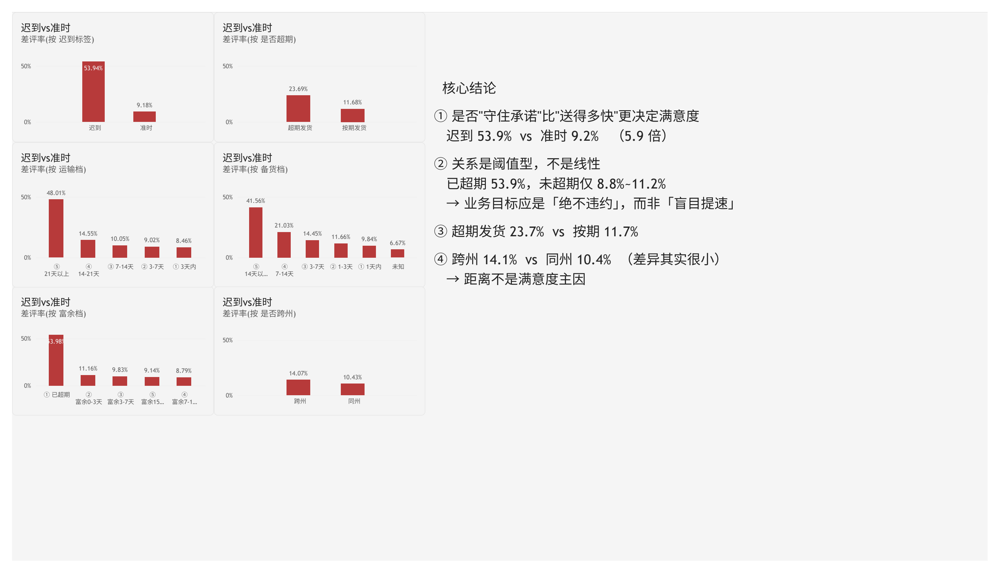
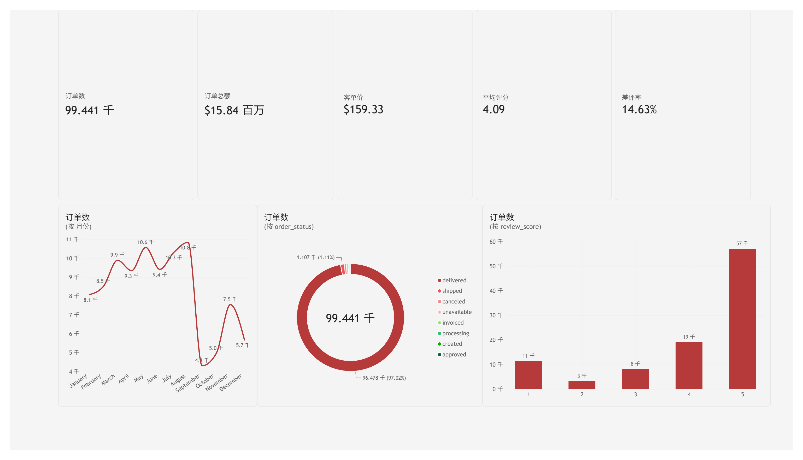
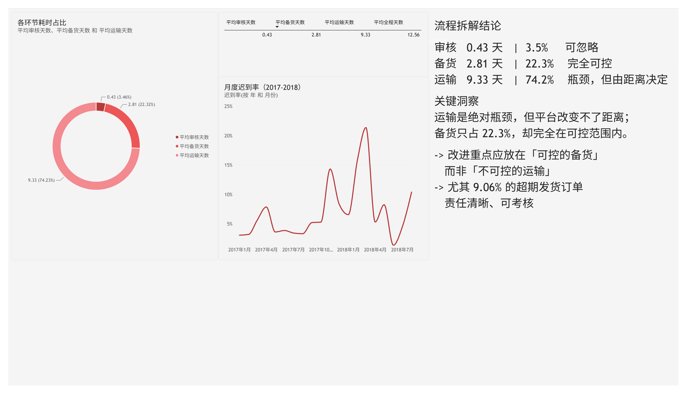
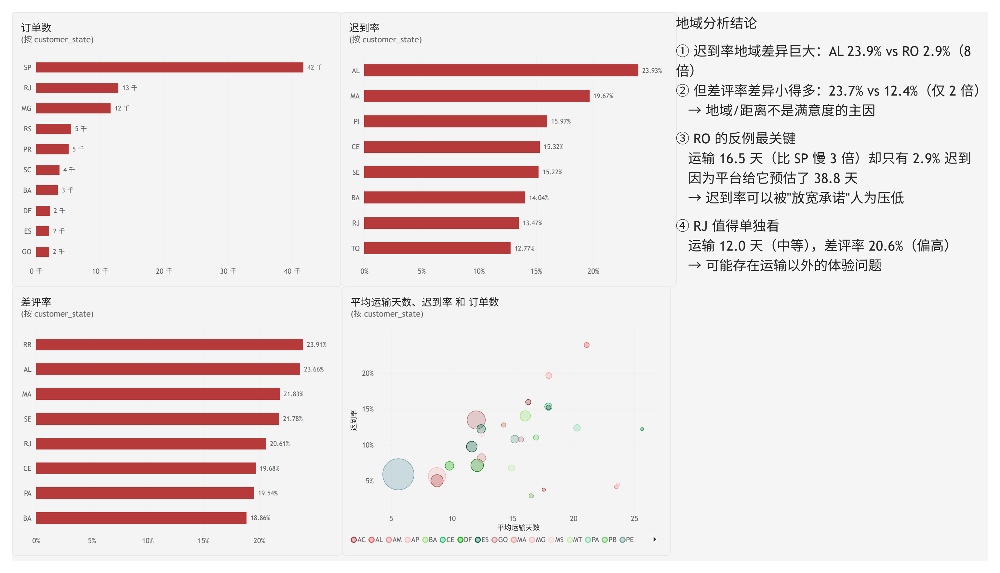
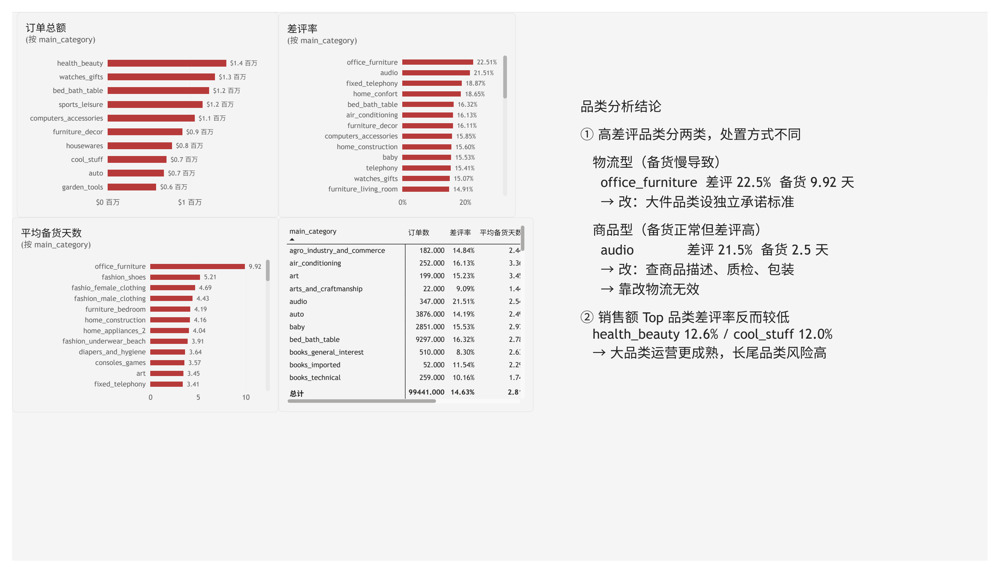
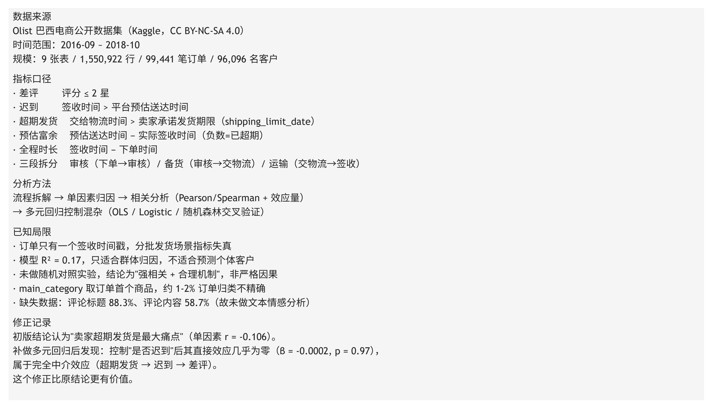

# Olist 巴西电商 · 客户差评归因分析

> 用 155 万行真实交易数据，回答一个业务问题：**为什么客户会给差评？业务该先改哪一件事？**

<p>
  
  
  
  
  
</p>

---

## 核心结论

| # | 发现 | 关键证据 |
|---|---|---|
| 1 | **「是否迟到」是差评最强预测因子** | 差评率 **53.94% vs 9.18%**（5.9 倍）<br>标准化 β = −0.277，Cohen's d = −1.41，OR = 1.457 |
| 2 | **关系是阈值型（悬崖），不是线性（斜坡）** | 已超期 **53.98%**；未超期各档仅 **8.79%–11.16%**<br>分段相关：全样本 r=0.256 → 未超期子集 r=**0.024** |
| 3 | **运输占全程 74.2%，是瓶颈但不可控** | 审核 0.43 + 备货 2.81 + 运输 9.33 = 12.56 天<br>运输由距离决定，平台无法改变 |
| 4 | **超期发货的效应被「迟到」完全中介** | 单因素 r=−0.106 → 控制迟到后 β=**−0.0002**（p=0.97）<br>因果路径：超期发货 → 迟到 → 差评 |
| 5 | **距离的作用被严重高估** | 相关 r=−0.058 → 控制运输时长后 β=**+0.064**（符号反转）<br>跨州 Cohen's d 仅 −0.12，可忽略 |

### 一个可执行的结论

如果关系是**线性斜坡**，业务应追求"越送越快"；但数据显示是**悬崖**——未超期时多等几天几乎不影响评分，一旦超期就断崖式恶化。

> **所以正确的目标不是"盲目提速"，而是"绝不违约"。**

---

## 关键图表

### 差评归因：六个因素横向对比



> 迟到 53.94% vs 准时 9.18%；超期 23.69% vs 按期 11.68%；跨州 14.07% vs 同州 10.43%
> ——「是否迟到」的跨度最大，「是否跨州」几乎没有差异。

<details>
<summary><b>展开查看其他仪表盘页面</b></summary>

**经营总览**


**流程拆解：运输占 74.2%**


**地域分析：AL 迟到率 23.9%，RO 仅 2.9%**


**品类分析：物流型 vs 商品型高差评**


**数据口径与局限**


</details>

---

## 项目概览

| 维度 | 内容 |
|---|---|
| 数据规模 | 9 张表 / **1,550,922 行** / 99,441 笔订单 / 96,096 名客户 |
| 时间跨度 | 2016-09 至 2018-10（25 个月） |
| 分析查询 | **31 条 SQL**（7 个部分，逐条验证通过） |
| 统计方法 | 相关分析、效应量、卡方检验、OLS、Logistic 回归、随机森林 |
| 建模样本 | 93,047 条记录 / 10 维特征，交叉验证 **AUC = 0.744** |
| 交付物 | 分析报告 + 6 页 Power BI 仪表盘 + 31 张结果图 + 可复现代码 |

---

## 分析方法

采用四层递进的分析链路，每一层都为下一层提供方向：

```
① 沿业务流程拆解
   把"配送"拆成 审核 → 备货 → 运输 三段
   发现运输占 74.2%，后续分析重心由此确定
        ↓
② 单因素归因
   逐个排查 地理 / 卖家 / 商品 / 时间 四类因素
   用分组对比控制变量（每次只让一个因素变化）
        ↓
③ 相关分析与显著性检验
   Pearson + Spearman 双口径、Cohen's d 效应量、卡方检验
        ↓
④ 多元回归验证
   OLS + Logistic + 随机森林 三种方法交叉验证
   ★ 正是这一步推翻了两个单因素结论
```

### 关键设计：区分「配送时长」与「是否迟到」

这是整个分析的起点，也是 90% 新手会混淆的地方：

| 概念 | 定义 | 衡量什么 |
|---|---|---|
| 配送时长 | 签收时间 − 下单时间 | **绝对快慢** |
| 是否迟到 | 签收时间 > 预估送达时间 | **是否违约** |
| 差评 | 评分 ≤ 2 星 | 主观评价 |

一单送了 20 天，如果平台预估 25 天，它**不算迟到**；另一单送出 10 天、预估 7 天，它**迟到了**。

---

## 项目结构

```
olist-review-attribution/
│
├── sql/                          # SQL 全部在这里
│   ├── 01_create_schema.sql      #   建 schema 与表
│   ├── 02_import_data.sql        #   导入 9 个 CSV（\copy）
│   ├── 03_constraints_views.sql  #   外键、索引、分析视图
│   ├── 04_data_exploration.sql   #   数据探索与质量检查
│   ├── 06_factor_analysis.sql    #   ★ 31 条归因查询（7 个部分）
│   └── 07_pbi_view.sql           #   ★ BI 专用订单级宽表
│
├── python/                       # Python 脚本与输出
│   ├── stat_analysis.py          #   相关分析、效应量、卡方检验
│   ├── rigorous_model.py         #   ★ OLS / Logit / 随机森林
│   ├── shoot_results.py          #   SQL 结果截图
│   ├── make_github_report.py     #   报告自动生成
│   └── output/                   #   8 张统计图 + 13 个结果 CSV
│
├── powerbi/                      # 仪表盘
│   ├── olist_dashboard.pbix      #   Power BI 工程文件
│   ├── measures.dax              #   17 个度量值 + 7 个计算列
│   └── screenshots/              #   6 页仪表盘截图
│
├── docs/                         # 文档
│   ├── report.docx               #   ★ 完整分析报告（Word）
│   ├── report.pdf                #   ★ 完整分析报告（PDF）
│   ├── dashboard.pdf             #   仪表盘导出
│   └── sql_results/              #   31 张 SQL 查询结果截图
│
└── data/                         # 原始 CSV（gitignore，需自行下载）
```

## 📄 完整报告

- [**report.docx**](docs/report.docx) —— Word 版完整报告（35 页，含 6 页仪表盘横版展示）
- [**report.pdf**](docs/report.pdf) —— PDF 版，适合直接阅读
- [**dashboard.pdf**](docs/dashboard.pdf) —— 仪表盘单独导出

---

## 快速复现

### 1. 下载数据

从 Kaggle 下载 [Olist Brazilian E-Commerce Public Dataset](https://www.kaggle.com/datasets/olistbr/brazilian-ecommerce)（9 个 CSV），放入 `data/` 目录。

### 2. 建库导入

```bash
psql -h 127.0.0.1 -U postgres -d analysis -f sql/01_create_schema.sql
psql -h 127.0.0.1 -U postgres -d analysis -f sql/02_import_data.sql
psql -h 127.0.0.1 -U postgres -d analysis -f sql/03_constraints_views.sql
psql -h 127.0.0.1 -U postgres -d analysis -f sql/07_pbi_view.sql
```

### 3. 跑分析

```bash
python python/stat_analysis.py     # 相关分析 → 5 张图 + 7 个 CSV
python python/rigorous_model.py    # 多元建模 → 3 张图 + 6 个 CSV
```

### 4. 打开仪表盘

用 Power BI Desktop 打开 `powerbi/olist_dashboard.pbix`，数据源指向本地 `analysis` 库的 `olist` schema。

---

## 关键代码片段

### 四段耗时拆解（整个分析的分诊环节）

```sql
SELECT
  round(avg(EXTRACT(EPOCH FROM (order_approved_at - order_purchase_timestamp))
            / 86400)::numeric, 2) AS 下单到审核_天,
  round(avg(EXTRACT(EPOCH FROM (order_delivered_carrier_date - order_approved_at))
            / 86400)::numeric, 2) AS 审核到发货_天,
  round(avg(EXTRACT(EPOCH FROM (order_delivered_customer_date
            - order_delivered_carrier_date)) / 86400)::numeric, 2) AS 发货到签收_天,
  count(*) AS 样本数
FROM olist.orders
WHERE order_delivered_customer_date IS NOT NULL
  AND order_approved_at IS NOT NULL
  AND order_delivered_carrier_date IS NOT NULL;
```

### 悬崖效应的证明（分段相关）

```python
# 全样本：r = 0.2559（看起来中等相关）
# 仅未超期：r = 0.0241（关系几乎消失）
# → 整体相关性完全由"已超期"这 7.6% 的样本驱动
```

---

## 数据局限

| 局限 | 影响 |
|---|---|
| 订单只有一个签收时间戳 | 分批发货场景指标失真，多卖家订单不采信 |
| 模型 R² = 0.17 | 只适合群体归因，不适合预测个体客户 |
| 未做随机对照实验 | 结论为"强相关 + 合理机制"，非严格因果 |
| 评论缺失率高（内容 58.7%） | 未做文本情感分析 |
| `main_category` 取订单首个商品 | 约 1–2% 订单品类归类不精确 |

### 修正记录

初版结论认为"**卖家超期发货是最大痛点**"（单因素 r = −0.106）。

补做多元回归后发现：控制"是否迟到"后其直接效应几乎为零（β = −0.0002, p = 0.97），属于**完全中介效应**（超期发货 → 迟到 → 差评）。

> 这个修正直接改变了建议方向——从"考核发货率"改为"考核准时送达率 + 管住预估窗口"。

---

## 数据来源

数据来自 [Olist 巴西电商公开数据集](https://www.kaggle.com/datasets/olistbr/brazilian-ecommerce)，
采用 **CC BY-NC-SA 4.0** 许可。本仓库仅包含分析代码与结果，**不包含原始数据文件**。

---

## License

代码部分采用 [MIT License](LICENSE)。
数据集版权归 Olist 及原始发布方所有，遵循 CC BY-NC-SA 4.0。
